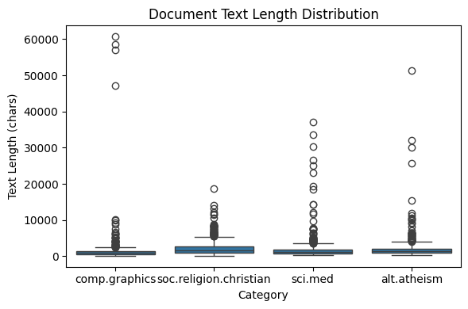
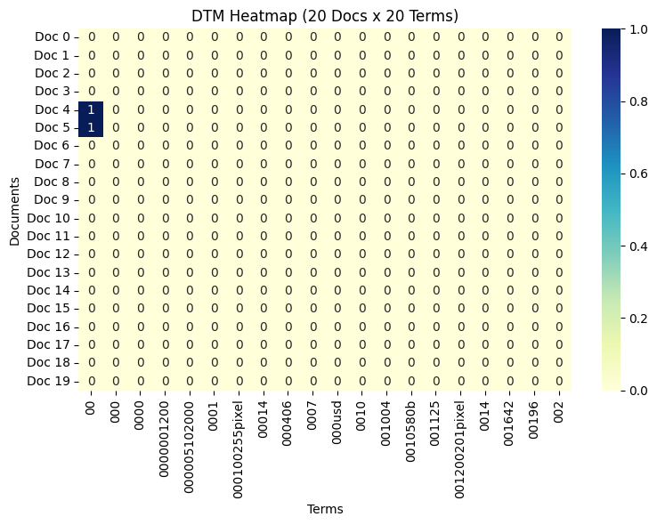
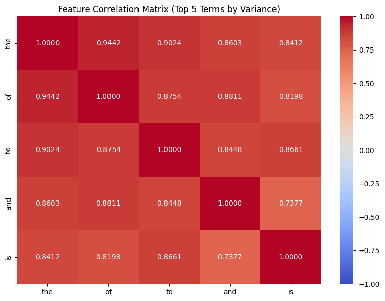
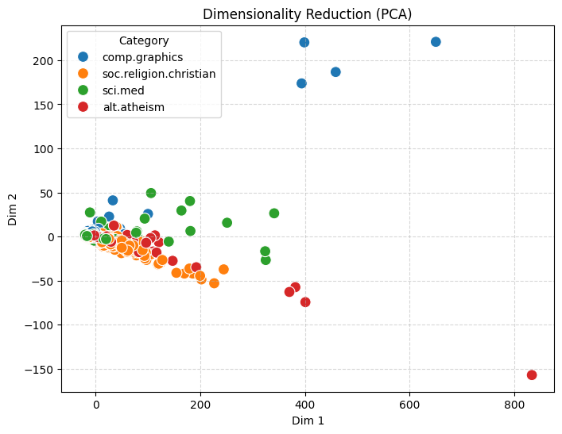
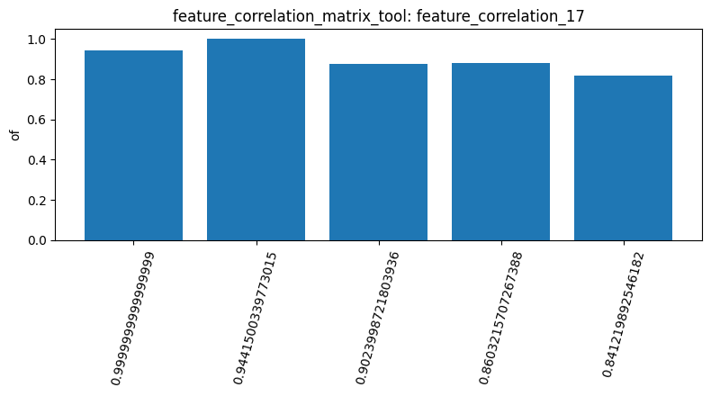

# 張寶珠 (112006201) 

# AgenticPipeline Report

## 1. Dataset overview

I used the 20 newsgroups dataset with 2257 documents across four categories, (comp.graphics, sci.med, soc.religion.christian, alt.atheism)(load_dataset_1). After inspecting the dataset (inspect_2), I checked for any missing values and duplicates (check_missing_3, check_duplicates_4), and both returned zero which means the dataset was already complete and did not contain any duplicate document so, no additional cleaning was needed for these issues. The document statistics (describe_5) shows that soc.religion.christian has the highest average document length (2263 characters), while comp.graphics has the lowest (1557 characters). There were also several extreme outliers, showing that document lengths varies quite a lot across the dataset.

## 2. Text analysis and filtering

I constructed a document term matrix with 2257 documents and 35788 terms (build_dtm_6). It had 99.55% sparsity, which means most of the terms were absent from most documents. The term frequency analysis (term_freq_7) showed that common words such as the, of, and to appeared most frequently. Based on this, I noticed that the most frequent terms were not neccesarily the most useful for understanding the topics, since they are words commonly used in almost every document. The DTM heatmap (dtm_heatmap_8) also showed only 2 nonzero values in the selected 20×20 section, though this small section does not necessarily represent the entire matrix. For feature selection, variance filtering (variance_filter_9) retained 5354 terms at a threshold of 0.01, while ppearson filtering (pearson_filter_10) retained none at a threshold of 0.8. The difference in the two results shows how much the filtering criteria could affect which features were selected. In particular, the pearson threshold seemed too strict for this dataset, since it did not retain any terms. Neither filter permanently changed the original DTM, so these results were useful for evaluating the selection criteria rather than actually reducing the dataset.

## 3. Pattern mining and correlations

I used FP growth to mine frequent patterns in sci.med (mine_patterns_11). It returned 17 frequent patterns, but all were single terms rather than combinations of words, so the results didnt really reveal meaningful word associations. This could be because common words were dominating the dataset, making it harder to identify patterns that were actually related to medical topics. I also converted the category labels into a 2257x4 binary matrix (binarize_labels_16). The feature correlation analysis (feature_correlation_17) showed strong positive correlations (0.7377–0.9442) between the five selected common words: the, of, to, and, and is. Since these words are used across different topics, I think the strong correlations may reflect general writing patterns rather than meaningful relationships between the categories.

## 4. PCA and document similarity

I applied PCA to reduce the DTM to two dimensions (reduce_dimensions_12). The first two components explained 70.27% of the total variance, but the visualization still showed considerable overlap between the four categories, along with some extreme outliers. This suggests that PCA captured most of the variance but did not effectively separate the documents by topic. I also compared document similarity using cosine similarity. Two documents from comp.graphics had a similarity of 0.3532 (cosine_similarity_13), while a pair from different categories scored 0.3289 (cosine_similarity_15). The scores were quite close, suggesting that documents from different categories may still share similar vocabulary. However, two comparisons arent enough to draw a general conclusion about document similarity.

## 5. Overall findings and limitations

Overall, the analysis showed that text data can be highly sparse and that common words can strongly affect the results. Variance filtering identified many low variance terms, but the Pearson threshold was too restrictive. Pattern mining mostly returned individual words, while PCA did not clearly separate the categories despite explaining 70.27% of the variance. We also encountered a gemini context overflow error during Spearman filtering, so that step was not completed. The final bar chart was generated using feature_correlation_17, but its numerical labels made it less useful than the correlation heatmap. From these results, I found that feature selection, text representation, and the choice of parameters are important when interpreting text mining results.

