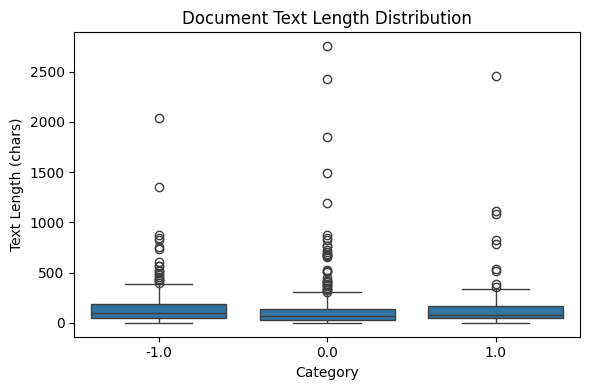
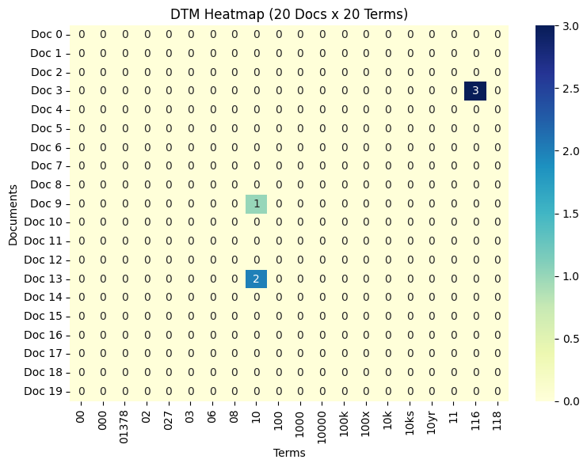
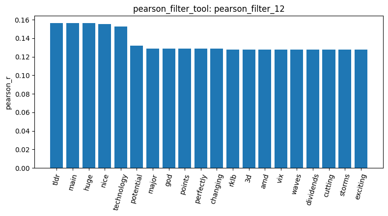
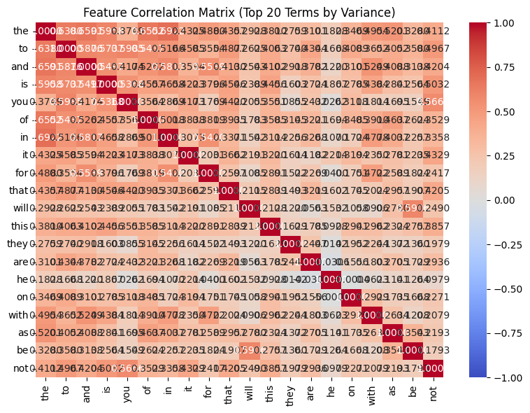
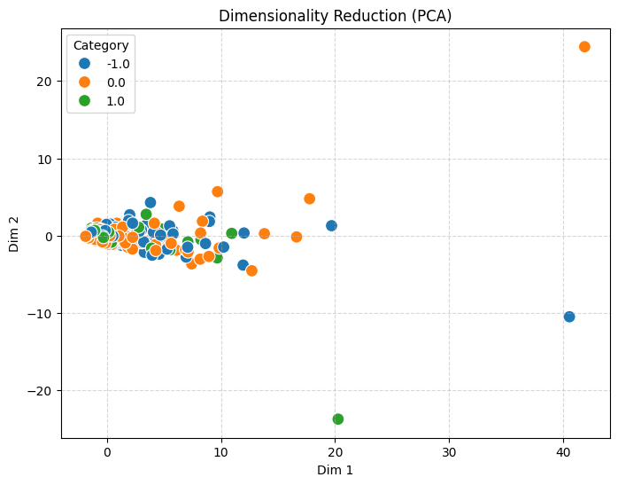

# 張寶珠 (112006201)

## Homework Report — Reddit Stock Sentiment Analysis

## 1. Dataset overview and cleaning

I used the reddit stock sentiment dataset with 847 documents across three sentiment categories (negative (-1.0), neutral (0.0), and positive (1.0)) (load_dataset_1). After inspecting the dataset (inspect_2), I checked for missing values (check_missing_3) and found none which means the dataset was already complete. However, the duplicate check (check_duplicates_4) found 23 duplicates, so I removed them using keep=False, leaving 813 documents (check_duplicates_5). The document statistics (describe_6) showed that positive posts had the highest average length (166.04 characters), while neutral posts had the lowest (139.08 characters). Although positive posts had the highest average length, their median was actually lower than negative posts. This makes me think that the difference in averages may have more to do with a few longer posts rather than positive sentiment itself.

## 2. Text analysis and feature filtering 

I built a document term matrix with 813 documents and 4313 terms (build_dtm_7). It had 99.52% sparsity, which was almost the same as our previous 20 newsgroups dataset despite having a much smaller vocabulary. Term frequency analysis (term_freq_8) showed that common words still appeared most frequently, while the DTM heatmap (dtm_heatmap_9) contained only three nonzero values in the selected 20x20 section. Variance filtering at 0.01 retained 490 terms (variance_filter_10), while pearson filtering at 0.8 retained none (pearson_filter_11). After lowering the pearson threshold to 0.1, it retained 41 terms for positive sentiment (pearson_filter_12) and 18 for negative sentiment (pearson_filter_13). The positive terms included words like nice and exciting, while the negative terms were more related to politics and economics, such as trump, china, and trade. This suggests that the words associated with a sentiment category dont necessarily express that sentiment themslves, since they could also reflect what people are discussing.

## 3. Pattern mining and corelations

The feature corelation analysis (feature_correlation_14) showed positive relations between frequently used words such as the, to, and and, suggesting that common vocabulary still influenced the feature relationships. For pattern mining, the initial term frequency approach failed with an encoding error, so I tried TF-IDF filtering instead. Using FP growth with min_sup=10, positive sentiment returned only 2 patterns (mine_patterns_15), while negative sentiment returned 30 (mine_patterns_16). Since the negative category had more documents, I lowered the positive category's min_sup to 4, increasing its pattern count to 32 (mine_patterns_17). This suggests that the original difference was partly affected by the unequal category sizes and the support threshold, rather than sentiment alone. However, all patterns were still single words, so finding more patterns didnt necessarily mean finding more meaningful word relationships.

## 4. PCA and document similarity

I used PCA to reduce the DTM to two dimensions (reduce_dimensions_18). The first two components explained only 31.82% of the total variance, and the three sentiment categories overlapped considerably, with several extreme outliers. Compared to 20 newsgroups, which had 70.27% explained variance, the reddit dataset appeared harder to represent in two dimensions. I also compared document similarity using cosine similarity. Two neutral documents had a similarity of 0.2004 (cosine_similarity_20), while a neutral and positive pair scored 0.1882 (cosine_similarity_21). The scores were quite close, suggesting that sharing the same sentiment does not necessarily mean documents have similar vocabulary. However, two comparisons are not enough to draw a general conclusion. I also converted the sentiment labels into an 813x3 binary matrix (binarize_labels_22).

## 5. Overall findings and limitations

Overall, the analysis showed that the Reddit dataset was highly sparse and that common vocabulary continued to influence the results. Pearson filtering became more useful after adjusting the threshold, while FP Growth showed how comparing categories with different document counts could be misleading when using the same minimum support. PCA also showed considerable overlap between sentiment categories. The main limitation was that most methods focused on word frequencies or vocabulary relationships rather than sentiment directly, so the results did not always distinguish positive, neutral, and negative posts clearly. From these results, I think choosing suitable parameters and checking whether comparisons are fair are just as important as successfully running the tools.
